# BetterLoka

A client-side Fabric mod for **[Loka](https://lokamc.com)** (`play.lokamc.com`), Minecraft **26.3**.

BetterLoka adds an in-game menu, opened with a key you bind yourself, that pulls live data from
Loka's public API and from [EldritchBot](https://eldritchbot.com). It is entirely client-side: it
never talks to the game server and sends nothing about you anywhere — with one exception you opt
into: a question you ask **Loka Assistant** goes, with your name, to the assistant server you set.

## Modules

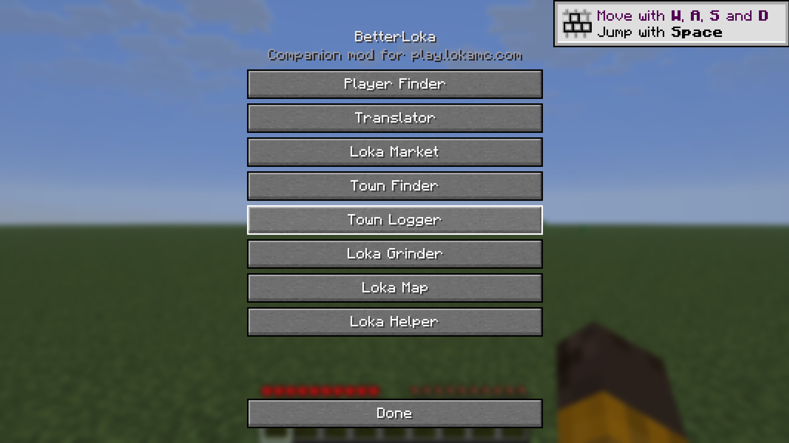

| Module | Status |
| --- | --- |
| **Player Finder** | Working |
| **Translator** | Working |
| **Loka Market** | Working |
| **Loka Map** (with towns) | Working |
| **Town Logger** | Working |
| **Loka Grinder** | Working |
| **Loka Helper** | Working |
| **Lore Creator** | Working |
| **Loka Assistant** | Working (needs an assistant server) |


## Player Finder

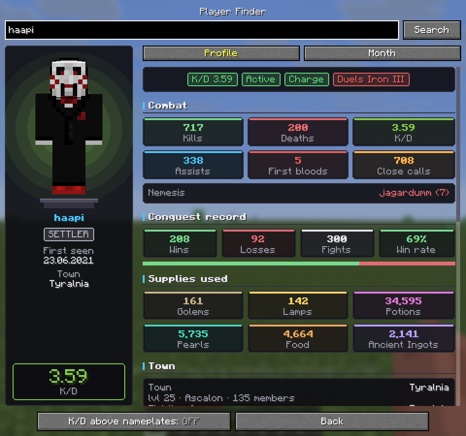

Type a Loka player's name, hit Search, and their whole Conquest record comes back in about a second,
laid out like a market item's profile:

- **On the left, the player themselves** — their own skin in 3D, turning slowly on a stand over a
  glow in their K/D's colour. Drag it to turn it yourself. Under it: their name, their Loka rank (or
  **IN FIGHT** when they are in one right now), when they first appeared on Loka, and their **K/D** on
  a tag at the foot of the stand.
- **On the right, the numbers**, in coloured tiles:
  - **Conquest Elo** — the rating, the place on the leaderboard, the best it has been and how many
    rated fights it rests on, from [loka-elo.pages.dev](https://loka-elo.pages.dev) (below); the
    rating hangs on a second tag at the foot of the stand, beside the K/D
  - **Combat** — kills, deaths, K/D, assists, first bloods, close calls, and their nemesis (whoever
    has killed them most)
  - **Conquest record** — wins, losses, fights, win rate, and a bar of wins against losses
  - **Supplies used** — golems, lamps, potions, pearls, food and ancient ingots
  - Their **town** — level, continent, member count, whether it is recruiting — and **who they
    currently fight for**, since Loka lets players reinforce towns other than their own
  - **RIVI vs Conquest**, **Ranked 1v1**, and their **last 5 fights** (below)

The skin is the one the game already has when the player is on the same server; anybody else's is
asked of Mojang by UUID and drawn by the game's own skin manager, exactly as for a player you meet.
Until it arrives — a moment — the default skin stands in.

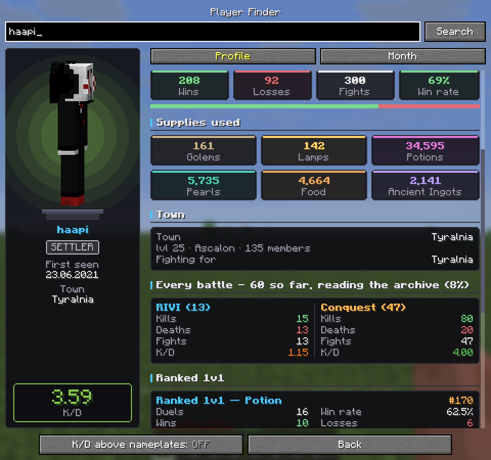

Name lookup is case-insensitive.

### Trait chips

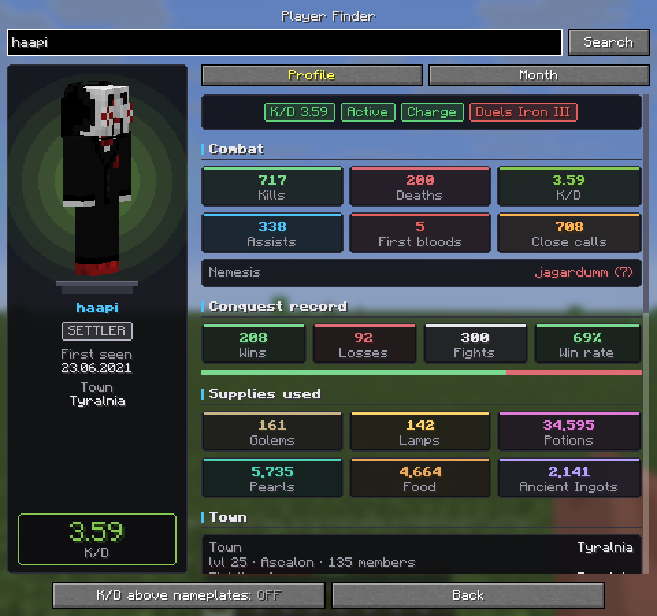

A row of coloured chips under the name, summing up how someone plays. Hover one and it says what
earned it. Green, yellow, red — and **no chip at all** when there is nothing to base one on, because
"does not duel" and "duels badly" are different claims and only one of them is an accusation.

| Chip | Green | Yellow | Red | Absent |
| --- | --- | --- | --- | --- |
| **K/D** | above 3.00 | 1.00 to 3.00 | below 1.00 | never fought |
| **Active** | every listed fight inside 30 days | 1–8 fights in 30 days | none in 30 days | — |
| **Charge** | 0.70+ charges a fight | 0.15 to 0.70 | below 0.15 | under 10 fights |
| **Duels** | above Diamond III | Emerald I to Diamond III | below Emerald I | not on either ladder |

Two of these are not quite what was asked for, because the data does not go that far:

- **Charge** was meant to be a success rate. Nothing publishes one: EldritchBot records every charge
  a player *took* — the count matches their golems and lamps exactly, in every fight checked — and no
  source anywhere records how many they went for, so there is no denominator to divide by. Charges
  per fight is the measure the data supports, and it still separates the dedicated charge-takers
  from the players who never touch it. The cuts are 0.70 and 0.15; across a sample of live careers
  the spread ran 0.00 to 2.15 with a median of 0.64, so 0.70 is about the top third.
- **Active** was meant to be "more than 10 fights in 30 days". EldritchBot lists nine recent fights
  and stops, so past nine there is nothing to count. Green therefore means *every listed fight was
  inside the window* — at least nine, and the list ran out — which the tooltip says outright.

### RIVI vs Conquest


The two formats side by side — kills, deaths, assists and K/D each.

A fight is RIVI when EldritchBot names its map `the_*`: the_rivi_shores, the_jade_highlands,
the_verdant_hollows. Across every fight sampled those run about twenty players, against fifty to two
hundred and seventy on the Conquest territories, whose maps are named after the biome exactly as
Loka's own territory list has them. A live test re-checks that on every run, because if the naming
ever changes the split would quietly file fights under the wrong format.

**This is a sample, not a career.** EldritchBot publishes career totals as one lump and lists only
the nine most recent fights per player, and which map a fight was on is on that fight's own page —
so the split can only cover those nine, and the header says how many it is over.

### Month

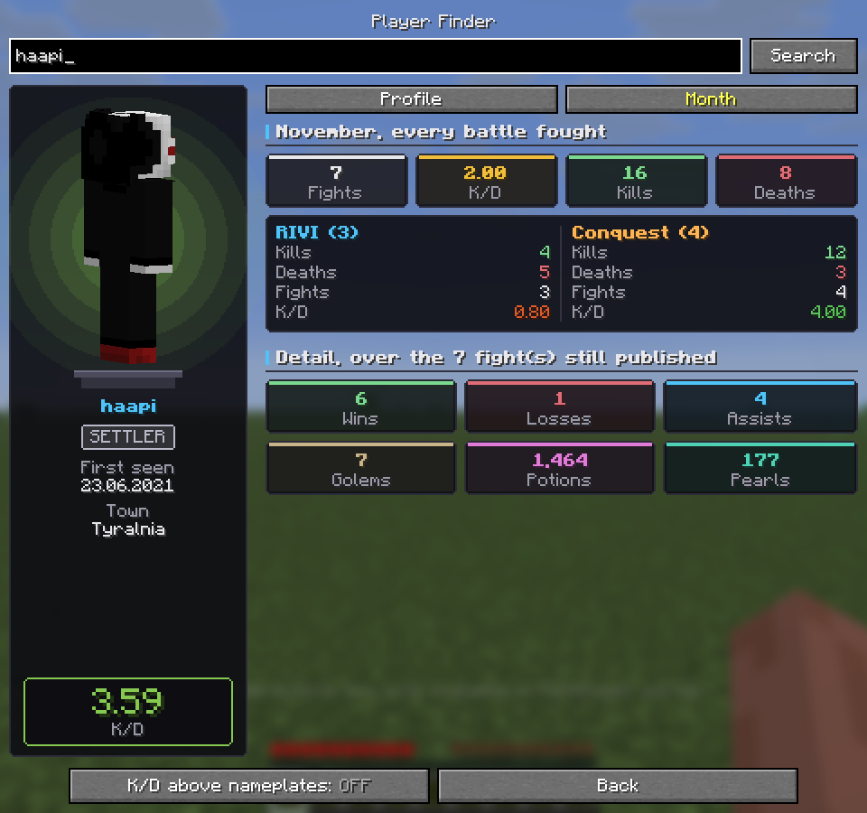

The current calendar month: fights, wins, losses, win rate, K/D, kills, deaths, assists, golems,
lamps, potions, pearls, and how many of the month's fights were RIVI. Same nine-fight ceiling, same
caveat in the header.

### Ranked 1v1

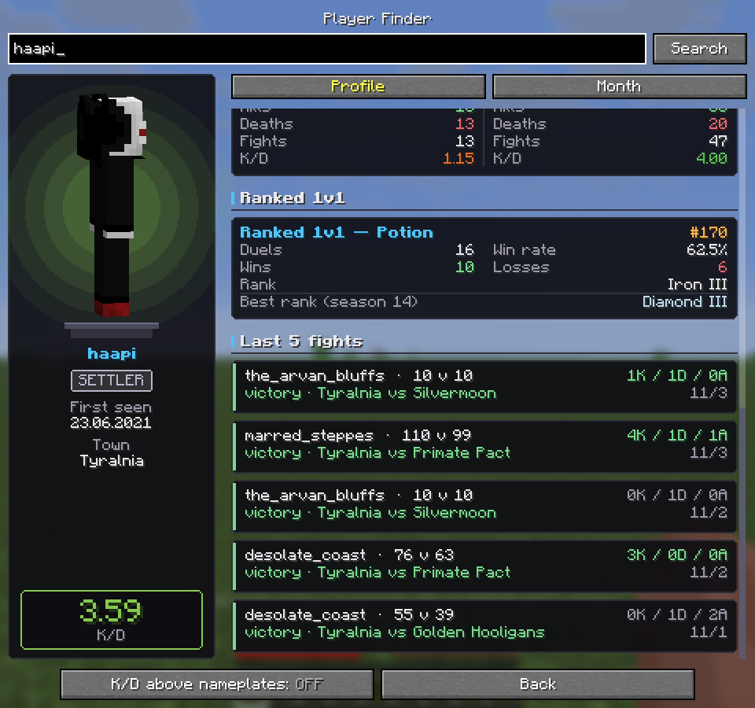

Below the Conquest record, both of Loka's ranked 1v1 ladders — Potion and Barebones — with this
season's **duels, wins, losses, win rate, rank** and ladder position, and underneath it the **best
rank they have ever held and the season they held it in**.

Loka publishes ladders rather than players, so a lookup means fetching a ladder and indexing it: the
current standings are two requests and arrive with the rest of the profile. "Best rank ever" needs
every past season's final table — about forty requests — so it is built once in the background and
the line fills in when it lands. Both are shared by every player you then look up.

A season's weekly snapshots are cumulative, which is what makes its **last published week** that
season's result and keeps this to one table per season rather than one per week. Players are followed
by UUID, not by name, because names change between seasons.

### Conquest Elo

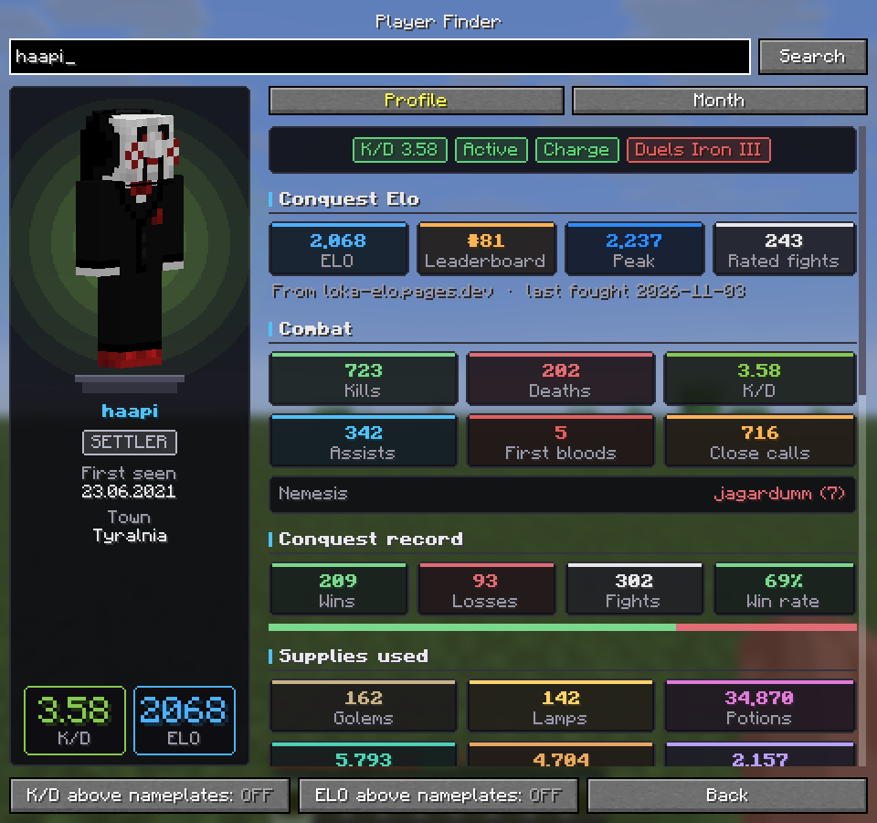

[Loka Elo](https://loka-elo.pages.dev) rates every Conquest player from their fights. The site
publishes its whole leaderboard as one static file — every rated player with UUID, name, former
names and rating — which is exactly what its own page loads, and that file is all the mod reads: about
a megabyte compressed, fetched once per version (the site regenerates it about daily), kept on disk
(`elo.json`) and checked for a newer one every half hour. The site's `/api/` is behind a challenge
and disallowed to robots, and is never touched; players the site hides are hidden here too.

Because the whole leaderboard is on disk, a lookup is instant and costs nothing — which is what lets a
nameplate carry a rating without a request per player.

### A player who has renamed

EldritchBot answers by name, so somebody who renamed yesterday 302s away from their new one, and an
old name finds nobody at all — even while they are standing on the server. The mod finds the
**account** behind the name instead and asks EldritchBot by UUID, which it answers whatever the
player is called today. The account comes from the Elo leaderboard, which lists **every name each
account has had** — so a search for `jagardumm` finds Blissterz, `Rezorie` finds spookyrezor and
`xPabloFights_YT` finds babisoy, none of which Loka's own lookup could — or else from Loka. The card
shows the current name.

### Why a search is quick, every time

Searching the same names over and over against the live services, with everything the game runs in
the background running too, turned up the stall that came and went: **api.lokamc.com** sits behind
several nodes, each with a budget of about thirty requests refilling at about one a second, and when
background work spent a node's budget it answered 429 with a wait of up to **33 seconds**. The mod
held every request to the host for all of it — and the Player Finder's headline waited on Loka's
record of the player, so a search sat on "Searching" for half a minute with EldritchBot's numbers long
since in. Now:

- **The headline does not wait on Loka.** EldritchBot's numbers go out the moment they are in; Loka's
  rank and account age follow when Loka answers.
- **A 429 on background work holds back only background work.** One on a request somebody is waiting
  on holds it at most a second and a half, since the retry may well reach another node.
- **Background work stays under Loka's refill**: at most one and a half requests a second, and it stops
  while any node reports its budget low — the lowest reading of the last five seconds, not the last
  one, since readings alternate between nodes.

Sixteen searches in a row (renamed players included) under that load: every headline in 0.3–1.5 s.

### K/D, Elo and ping above nameplates

The three switches along the bottom of the Player Finder — **Above nameplates: K/D, ELO, Ping** — put
each player's K/D, their Conquest Elo and their **current ping** beside their name tag in the world —
`Name | 3.58 | 2068 ELO | 45ms` — each coloured by its band:

| K/D | Colour | | Elo | Colour |
| --- | --- | --- | --- | --- |
| below 1.0 | red to orange | | below 650 | red-orange |
| 1.0 – 3.0 | orange to yellow | | 650 – 849 (where everyone starts) | grey |
| 3.0 – 5.0 | yellow-green to green | | 850 – 1399 | yellow, light green |
| 5.0 – 10 | light blue, blue | | 1400 – 2199 | green, light blue |
| 10 – 20 | purple | | 2200 – 2999 | blue, purple |
| past 20 | gold | | 3000 and above | gold |

The Elo is looked up by the player's account in the leaderboard on disk, so it costs no request.
The ping is the one the server keeps the player list up to date with, read as the nameplate is
drawn — green to 60 ms, yellow-green to 120, yellow to 200, orange to 300, red past that — and costs
nothing either. A searched player who is on the same server shows **Online** and their ping, live,
on the Player Finder's stand.

K/D ratios are fetched in the background as players come into view, cached for fifteen minutes, and
capped at a handful of requests in flight, so a full fight fills in over a few seconds rather than
all at once.

The lookup uses the player's Mojang account name from the player list, not the text on the
nameplate: Loka decorates those with a rank ("Duelist Rezorie"), and searching a stats service for
that finds nothing.

The badge is added where the game builds the label — `EntityRenderer.getDisplayName` — rather than
by editing the render state afterwards, so it goes through vanilla's own nameplate placement,
scaling and occlusion.

## Translator

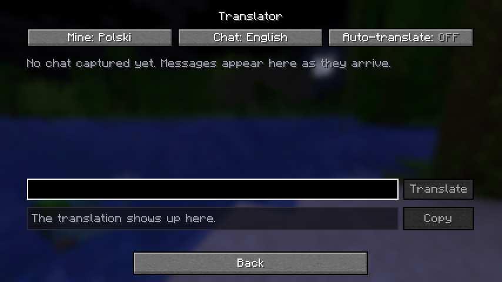

For playing on an English-speaking server without speaking English.

- **Reading**: turn *Auto-translate* on and every chat line is translated into your language as it
  arrives. The Translator shows the translation with the original underneath.
- **Writing**: type a reply in your own language, press **Translate**, and **Copy** puts the English
  version on your clipboard — paste it into chat.

Messages are listed newest first as `Name: message`. Only actual chat is kept — join notices,
territory announcements and command output are filtered out, so the conversation is not buried and
no requests are wasted translating them.

**Town and alliance chat are translated too**, and marked as such: a `[Town]` or `[Alliance]` badge
and a coloured spine down the left of the card. Loka does not label those channels in the text — it
colours them, green for town and light blue for alliance — so the mod reads the colour off the
message rather than its wording, and matches by hue so a hand-picked shade still counts. Team chat
is also parsed more loosely once identified, since it is often written `Name » message` rather than
`Name: message`.

Both languages are pickers, so this works for any pair the translation service supports, not just
Polish and English. The mod never sends anything to the server itself; you always paste it yourself.

## Loka Market

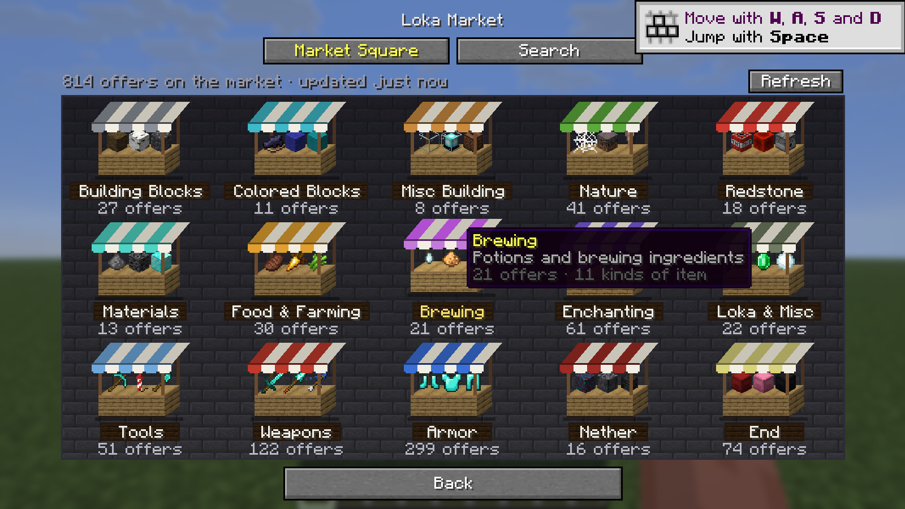

The Market opens on a **market square**: a stall for each kind of goods, drawn in three quarters
view out of the game's own block textures — a planked counter, posts, a striped awning in the
stall's colour — with the goods it has most of standing on the counter as real little item models.
Hovering a stall says what it sells and how much of it there is; clicking it opens the stall.

Fifteen stalls: **Building Blocks, Colored Blocks, Misc Building, Nature, Redstone, Materials,
Food & Farming, Brewing, Enchanting, Loka & Misc, Tools, Weapons, Armor, Nether, End**. Loka's API
has no categories — an offer is an item type, a price and a seller — so the stalls are the mod's
own, modelled on the game's creative tabs: every item is placed by its id (`_sword`, `_wool`,
`_ore`...), checked by a test against all 1,658 items in the game and every type on the market.
Loka's own items — Recall Stones, Reinforced Hoppers, Void Storage markers — are listed under a
type of Loka's over an ordinary material, and go to **Loka & Misc** with a *Loka* badge.

The square is the whole market: every page of `/market_sales` (the API hands out twenty offers a
page, so about forty-five requests), fetched ahead of time in the background and kept for ten
minutes. **Refresh** fetches it again now — on threads of its own and as a request somebody is waiting
on, which brings it in within a few seconds (measured: 45 pages in 3.7 s with the battle archive,
the ranked history and a stream of searches all running alongside). It used to queue behind those
in the shared background lane, paced as work nobody was watching, and took minutes.

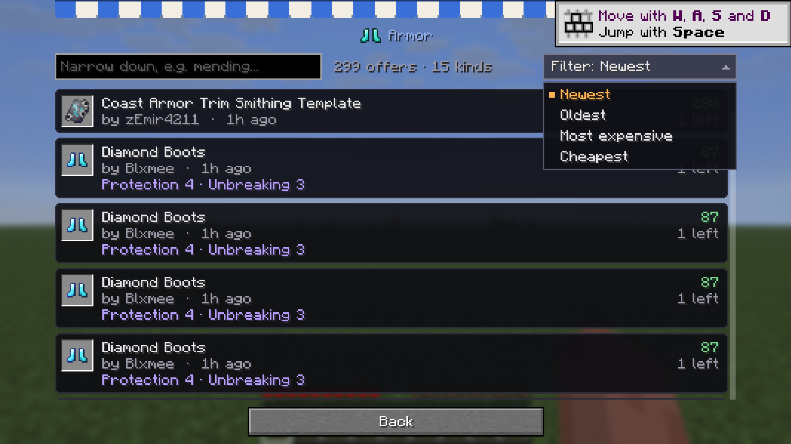

A stall lists every offer it has: the item in a slot, with its count, wear and enchantment glint;
its name in its own colours; the seller and when it was listed; the price and how many are left.
Hovering the item shows its tooltip. A field narrows the stall down by name or enchantment
(`mending`), and **Filter** puts it in one of four orders: **Newest**, **Oldest**, **Most
expensive**, **Cheapest**.

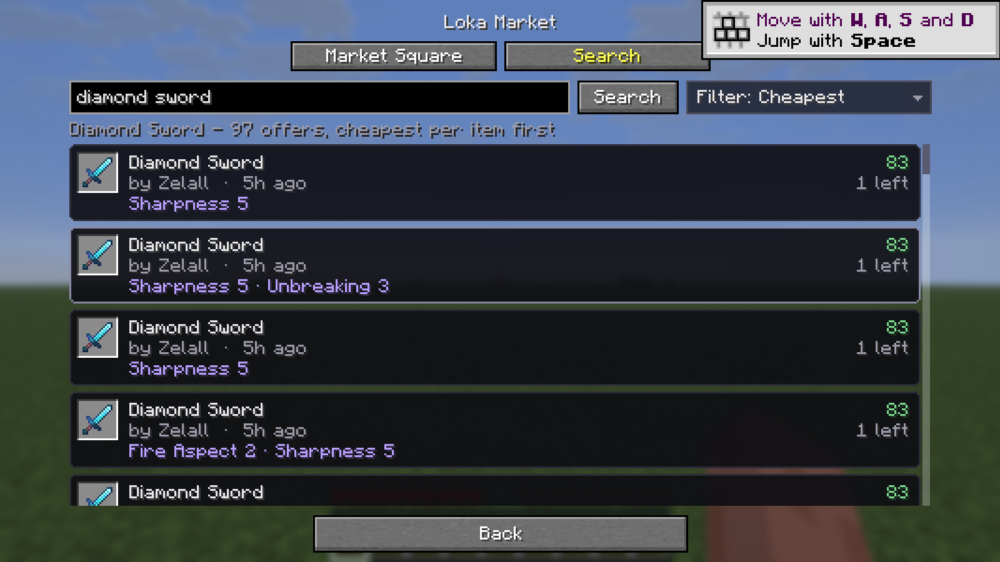

**Search** works as before: type an item — `diamond sword`, or `xp bottle` for Loka's own bottles —
and get every offer of it, with type suggestions as you type and the same Filter.

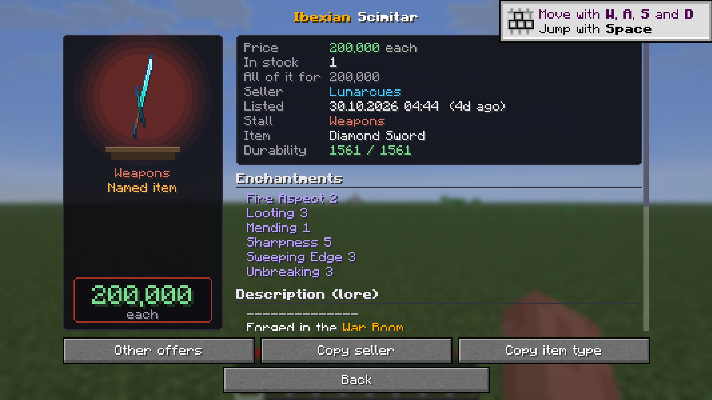

Clicking any offer opens its **profile**: the item four times its size on a stand, turning slowly,
with its name and lore exactly as the game colours them, its enchantments, durability or potion
effect, the seller, when it was listed, and what it costs a unit, an item and all told. **Other
offers** searches the same item; **Copy seller** puts the seller's name on the clipboard.

Prices are read as Loka's API documents them: `price` is for one unit, a stack of `stackSize`
items, of which `quantity` are left. A stack of sixty-four gunpowder at 390 is about six shards a
powder, and orders by price compare the price of one item, so a stack and a single can be compared.

## Loka Grinder

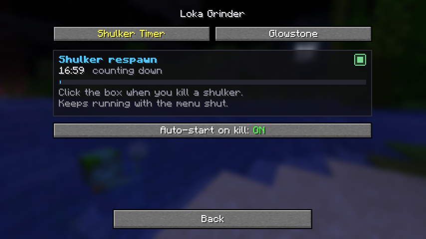

Countdowns for the things worth grinding. The timers live outside the screen, so they keep running
with the menu shut — a twenty-minute countdown that only advanced while you watched it would be no
use at all.

- **Shulker Timer** — 20 minutes, started by the box in the corner of the card. With **auto-start**
  on it also starts by itself when a shulker you hit dies — the first one, that is: killing more
  while the countdown runs does not restart it, since the twenty minutes are counting down to the
  next spawn and another kill does not move that moment. Once it reaches zero the next kill begins
  a fresh cycle.
- **Glowstone** — 3 hours, adjustable in five-minute steps with the `-` and `+` buttons.

Both have a **keybind** (`G` and `H` by default, rebindable in Options → Controls) that starts the
timer without opening anything, which is the point of it while you are grinding. Pressing it again
restarts the countdown — the second kill of the night should not be ignored because the first timer
is still running — and pressing it on a timer that has already run out clears it.

### On-screen countdown

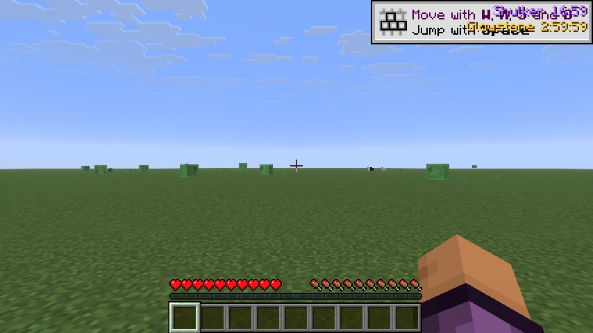

A running timer counts down in the **top right of the screen**: shulkers in purple, glowstone in
gold. It draws nothing until a timer is started, disappears when the timer is cleared, and each one
can be switched off from its own tab in the Loka Grinder screen.

Auto-start is deliberately narrow. The client is never told who landed a killing blow, so it works
from what it can see — which shulkers you swung at, and which of those then died. A shulker somebody
else finishes off after you also hit it will start the timer, and one killed with a bow will not
start it at all. The box stays the reliable way; auto-start only saves a click in the ordinary case.

## Loka Map

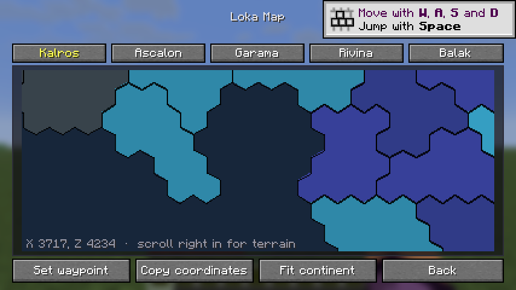

Loka's own map, drawn from Loka's own outlines, with all five continents: **Kalros, Ascalon, Garama,
Rivina and Balak**.

`map.lokamc.com` runs Dynmap and publishes each continent's territory borders as marker data — the
same file the website draws from. So the shapes here are not approximated from a beacon coordinate:
they are the real polygons, up to twenty-six sides apiece, 516 of them across the five continents.
About 440 KB in total, cached for a day, because a border moves when a territory is captured and not
otherwise.

Each territory is drawn exactly as the website draws it: its fill colour at the fill opacity the
marker file gives it, its outline colour at the file's outline opacity and weight, and the same
marker in the middle — the keep for a held territory, the plainer one for neutral ground. Those
values are copied rather than approximated because no fixed table could match them: across the five
continents the file uses six fill opacities, two outline opacities and two weights.

The claims are painted into the ground tiles once, as each tile is decoded in the background, rather
than drawn every frame. Drawing them per frame — one small quad per pixel of outline — was what made
the map lag: with a whole continent on screen it was twenty thousand quads and three tenths of a
second a frame. Painted into the tiles, a frame of the map costs well under a millisecond. When a
territory changes hands, every tile it touches is repainted in the background and swapped in place. **Hovering** one shows the card the website shows: the holding town, its alliance and
strength, its members and how many territories it holds.

The markers are Loka's artwork, so they are fetched at runtime the way a browser viewing the map
fetches them and cached under `config/betterloka/map-icons` — about ten kilobytes, once, and never
bundled into the jar.

Clicking a territory names it and offers two things:

- **Set waypoint** — drawn out in the world at the place itself, through walls and terrain, with the
  distance under it in metres or kilometres. It also lists in the corner of the screen with an arrow
  that turns as you do. Only waypoints for the continent you are standing on are drawn: a marker set
  on Kalros points nowhere useful from Garama.
- **Copy coordinates** — straight to the clipboard, in the form a command will take.

**Clear waypoints** removes them all; setting one on a territory that already has one takes that one
off.

Hit-testing is ray casting against the real outline rather than a bounding box. Loka's territories
are not rectangles, and a box would hand a corner to the neighbour.

### Panning, zoom, and where the ground is

It opens about six territories across — measured, not guessed: Kalros's territories have a median
width of 584 blocks, and a first attempt at two blocks to a pixel put one hex wider than the whole
panel. Drag to move, scroll to zoom about the cursor, **Fit continent** to get back out.

The ground is Loka's own, the tiles its website draws, fetched from `assets.lokamc.com` at whatever
zoom the screen needs and kept on disk. Each continent's coarsest level — the whole island in a few
dozen tiles, under two hundred across all five — is fetched in the background shortly after the game
starts, so opening a continent shows the island at once and sharpens as the closer tiles arrive. The
download button under the zoom controls fetches a continent's closer levels ahead of time as well.

The map opens on the centre Loka publishes rather than the middle of the territory outlines. That is
not cosmetic either: the geometric centre of Kalros is bare sea floor with no tiles at all, against
40 of 169 at Loka's own centre.

### Fights

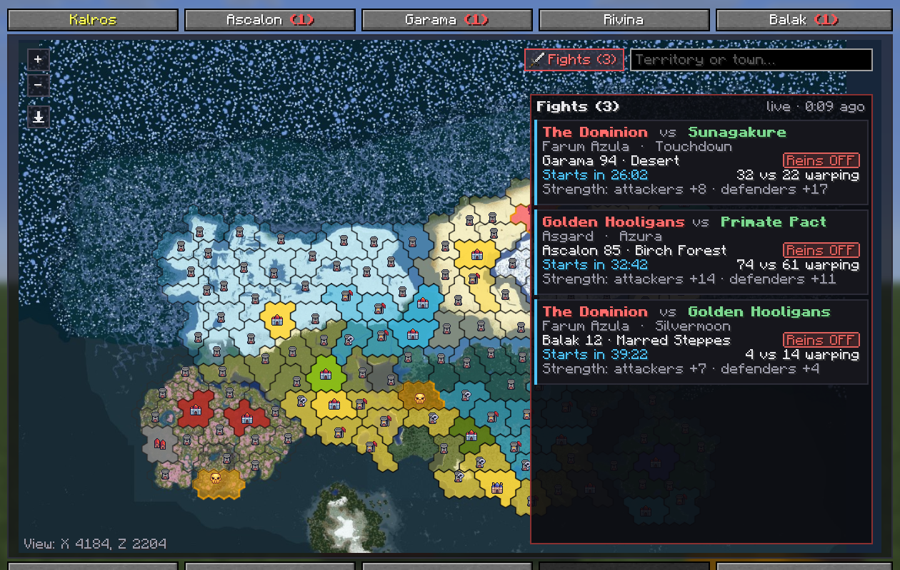

The fights Loka has on its books are on the map — the list the Fight Manager used to be. The
territory being fought over **blinks red**, with a sword on it and a countdown to the start, and the
continent tabs carry how many fights each has, so on opening the map it is plain where the fighting
is. The list itself starts **hidden**, so the map opens as a map: **Fights** over its top right
opens it, and picking a blinking territory or the banner of a new fight opens it on that fight.

Each fight in the list says who is fighting whom, their towns, where, whether reinforcements may be
called, when it starts and how many are warping in on each side. Clicking one flies the map to it
and opens its details; so does clicking a territory that is blinking.

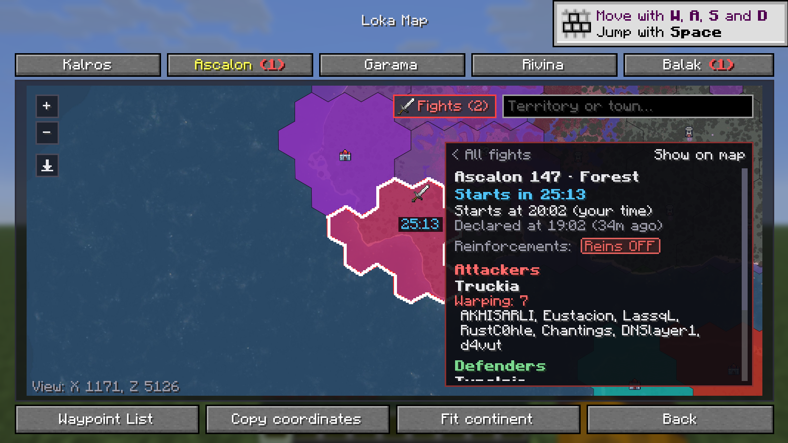

The details: the two sides, each with its alliance, town and strength and **everybody warping in by
name**; whether **reinforcements** are on; **when it starts** — a countdown and the clock time, in
your own time zone — and when it was declared; and the ground itself: its **mutator**, its
**bonus**, what it produces and what it is worth.

The start time is worked out, because Loka publishes none until a fight begins. It does not need to:
a fight goes off a fixed time after it is declared, and the declaration is in the record's id, a
MongoDB ObjectId. Read off two hundred fights over ten days of `/battlezones`, that time is fifteen
minutes for neutral ground, thirty for a held territory on Rivina and an hour for a held territory
anywhere else.

It is live: while the map is open the fights are asked for every fifteen seconds — one small request
— so a fight declared now is on the map within a quarter of a minute, announced across its top, and
the warping counts and names fill in as people sign up. Nothing is fetched while the map is shut.

### Towns

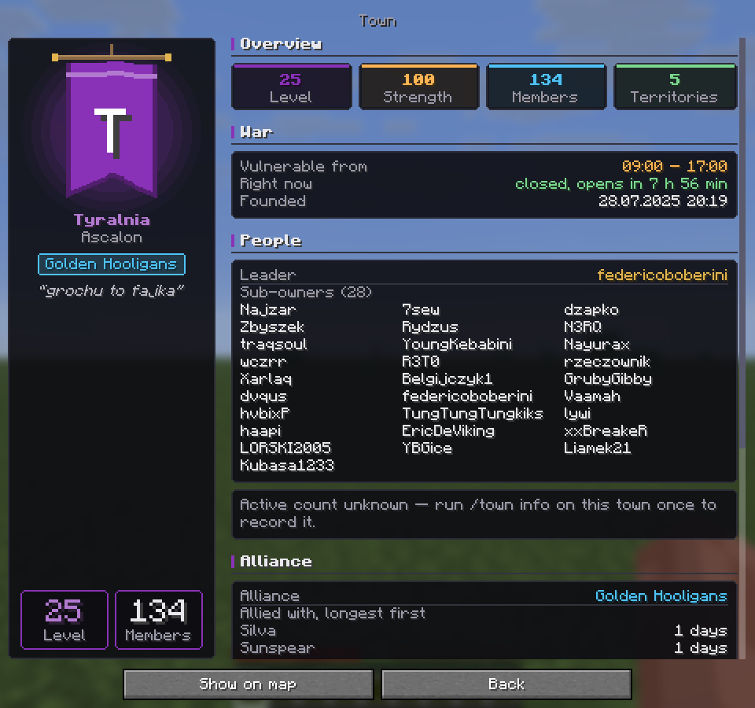

The Town Finder is gone; towns live on the map now. Click a territory — or search a town's name —
and **Town info** opens the town that holds it: its banner on the left, waving in the town's own map
colour with its initial on it, its name, standing (*Capital of Ascalon*), continent, alliance,
whether it is recruiting and its motto, with its level and members on tags at the foot; and on the
right, in tiles and cards:

- **Founded** — the date and time the town was made. Loka publishes no founding date, but every
  town's ID is a MongoDB ObjectID, which begins with the second the record was created. Sixteen of
  the eighty-odd live towns carry IDs stamped inside the same five seconds in May 2021 — Loka's
  oldest towns, given new records when the database they live in was built — so those read **"On
  record since"** rather than "Founded". Presenting an import as a founding would be inventing a
  fact.
- **Active members**, and how long the town has left — see below
- **Level, strength, members, territories**
- **Vulnerable from** — the eight hours it is attackable for, in your own clock, and **right now**:
  open with how long it has left, or closed with how long until it opens. Loka publishes the
  opening hour and publishes it in **UTC**: the API says 19 for a town whose in-game panel reads
  "9pm – 5am", so the number is converted rather than printed as it comes. The eight-hour length is
  the server's rule, confirmed against that panel.
- **Leader** and **sub-owners**, resolved from the identity IDs the roster stores them as, three to
  a row so a town with thirty of them still fits
- **Alliance** it belongs to now, and **who it has been allied with, longest first**
- Every **territory it holds** — its seat first — with number, area, coordinates and what it is
  worth; clicking one goes back to the map and flies to it, and **Show on map** does that for the
  seat.

A town that is gone is recognised from the deleted-town roster and says so.

#### When a town will be deleted

Loka deletes a town once it has gone **a month with no active members**. That makes the deletion date
knowable in advance, and the active count is the one number that decides it.

It is published nowhere. Every field of the town record was checked, on both the list and the
single-town endpoint, and on all 11,338 member entries across the live roster: a member entry carries
`subowner` and nothing else. The count exists only on the panel `/town info` opens.

So the mod reads it off that panel. Open `/town info <town>` yourself and the reading is recorded —
name, members, active, and when it was read. Nothing is sent: the mod never runs the command, it
looks at a screen you opened, which is the same screen you are looking at.

With a reading in hand the town shows the active count, when it was taken, and — once the
count is at zero — how many days it has been there and the date Loka could remove it.

That date is deliberately labelled **"no earlier than"**. The mod can only count from the first zero
*it* saw, and a town may have been at zero for weeks before anybody opened its panel, which would
bring the real date forward. Checking a town every few days tightens the estimate; any reading above
zero resets the clock, because the town was alive that day.

#### Who they usually ally with

Loka's API publishes the alliances that exist right now and keeps **no history at all**, and nothing
else publishes one either — so this is the one thing here that cannot be answered on the spot. The
Town Logger takes a reading of every alliance on each sweep (one small request) and counts the days
each pair of towns has been allied, so the list fills in from the day the mod is first run. Until
then it says so rather than showing nothing.

## Discord bot

[`bot/`](bot/README.md) is a separate program that watches for towns falling and **pings a Discord
role** when one does, with the continent, the territory number and the beacon coordinates — so people
can get to the territory while it is still open.

It is not part of the mod on purpose: the mod runs only while somebody's game is open, and on every
player's machine, so the channel would get one ping per player per town and nothing overnight. The
bot is one process watching on everyone's behalf.

It shares the mod's data layer rather than reimplementing it — `FallenTowns`, `LokaApi` and the
models compile straight out of `src/main/java` into the bot, so the two cannot disagree about what
counts as a fallen town.

It checks **every 30 seconds** and still costs about 1.6 MB an hour, because a town falling changes
nothing in the territory list — it changes the size of Loka's deleted-town list. Asking for that
count is one 1.2 KB request; the megabyte-sized sweep behind it runs only when the count moves.
Polling the territory list directly at that rate would have been ~100 MB an hour.

On first run it records the standing backlog **quietly** rather than announcing it: there are usually
a dozen long-dead towns still holding ground, and pinging a role with all of them is how a bot gets
muted.

```bash
./gradlew :bot:botJar
java -jar bot/build/libs/betterloka-bot-<version>.jar
```

### `/sprawdz <town>`

The bot also answers a slash command: **when a town was founded, and how recently each of its members
has been seen doing anything.** It exists to guess which towns are close to being deleted.

It needs a **bot token**, not a webhook — a webhook can only speak, and a slash command has to be
listened for. With one set, the bot opens a gateway connection (about 200 lines of `java.net.http`,
no Discord library) and registers the command itself. Without one, the fallen-town watch runs exactly
as before and the log says what `/sprawdz` would need.

**"Last seen" is not a login time, and the reply says so every time.** Loka publishes no last-login
field anywhere — there is no `lastSeen` on a player record and no online-players endpoint — so the
report uses the newest of two things that only happen while somebody is actually playing: their most
recent Conquest fight, per EldritchBot, and the newest item they have listed on the market, whose
ObjectID says when it was posted. It is a **lower bound**: a player who logs in daily but neither
fights nor trades leaves no trace in anything Loka publishes, and shows as "no record".

How much of the roster it checks is `maxMembersChecked` in the config (100 by default, `0` for no
limit) — but the owner and every sub-owner are always checked on top of it, and the rest are an even
spread rather than the first N, because Loka stores members in join order and the oldest accounts are
the least active ones.

The same report runs on the console without any Discord setup at all, which is the way to see what it
answers:

```bash
java -jar bot/build/libs/betterloka-bot-<version>.jar --check "Hilo"
```

See [bot/README.md](bot/README.md) for the webhook and bot-token setup.

## Town Logger

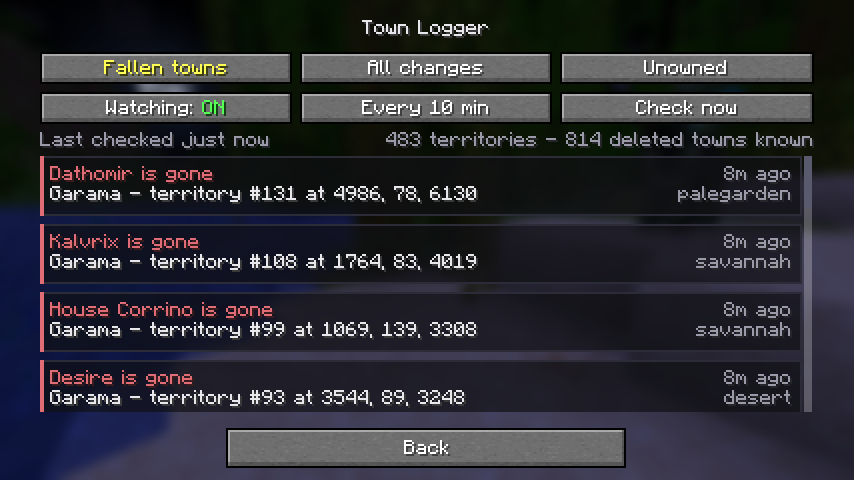

Which towns have fallen, and what they were holding.

The distinction the module exists for: a territory that moves from one living town to another was
**taken in a fight** and says nothing about either side. A territory that Loka still records to a
town it no longer has means that **town was deleted or collapsed** — and that is what the first tab
lists, with the continent, the territory number and the beacon coordinates.

That works because Loka does not clear a deleted town's claims: the territories keep pointing at an
id that no longer resolves. So the whole standing backlog appears on the **first sweep**, without
having to have been running when it happened. Naming the town takes the deleted-town roster, since a
deleted town 404s on a lookup by id.

Three tabs: **Fallen towns**, **All changes** (captures, releases and claims as they happen) and
**Unowned** (every territory nobody holds). The log is written to `config/betterloka/town-log.json`
and survives restarts, so the baseline is not lost between sessions.

### What it costs to leave running

A sweep is three requests — one per continent — and about 850 KB, and runs every **30 minutes** by
default, the first one 5 minutes after launch. The deleted-town roster is forty small requests and is
refreshed at most once an hour, since it only changes when a town dies. That is roughly **2.4 MB an
hour**, and none of it competes with a screen you are looking at — background requests yield their
place in the queue. The interval button offers 2, 5, 10, 30 and 60 minutes, **Check now** forces a
sweep, and the whole thing can be switched off.

## Installing

1. Install [Fabric Loader](https://fabricmc.net/use/installer) 0.20.0+ for Minecraft 26.3.
2. Drop [Fabric API](https://modrinth.com/mod/fabric-api) into `mods/`.
3. Drop `betterloka-<version>.jar` into `mods/`.

Then open **Options → Controls → Key Binds**, find the **BetterLoka** category, and bind
**Open BetterLoka menu** to whatever key you like. It defaults to `L`.

Settings live in `config/betterloka/config.json` and are written as you change them in the GUI.

## Where the data comes from

**EldritchBot** parses Loka's Conquest fight logs and publishes per-player career totals. It has one
JSON endpoint (`/api/player/<name>` — kills and deaths only, and case sensitive), so everything else
is read from the server-rendered player page, and each fight's breakdown from the fight page it
links to.

**Loka's own API** supplies rank, account age, town rosters, territory ownership, the deleted-town
roster and the battles running right now — the things EldritchBot does not track.

**Loka's ranked ladders** at `webapi.lokamc.com` are what the leaderboard page on the site reads, so
the mod reads them directly rather than scraping the page around them.

**Loka Elo** at `loka-elo.pages.dev` supplies the Conquest Elo and every name each account has had —
its public `meta.json` and `leaderboard.json`, the two files its own page loads, and nothing else.

**Mojang's session server** supplies a searched player's skin, through the game's own skin manager —
the same request the game makes for every player it meets.

**The assistant server you set** answers Loka Assistant's questions, and only those; see
[Loka Assistant](#loka-assistant) for what is sent.

A full profile is about ten requests and lands in roughly a second. The card appears as soon as the
career totals arrive; the fight rows fill in behind it.

Several things are done deliberately in the HTTP layer, all measured against the live services:

- Requests are paced by a token bucket, one per host. A 429 holds background work back for as long
  as the server asked, and a request somebody is waiting on for at most a second and a half.
- The client speaks **HTTP/1.1 on purpose**. Over HTTP/2 the JDK client multiplexes every request
  onto one connection per host and parallel work serialises behind it — the same sweep measured 8x
  slower, with rate-limit backoff on top.
- **Background work yields.** A sweep or an index build hangs back before taking its permit, so a
  search never queues behind traffic nobody asked for.

## Loka Helper

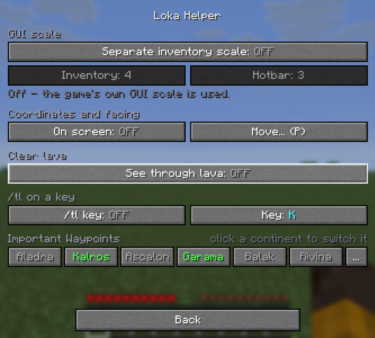

- **GUI scale** — an inventory big enough to hit a slot without aiming, and a hotbar that stays the
  size it was.
- **Coordinates and facing** — where you stand and which way you look (eight points, with the axes:
  *North-East +X -Z*), in a small box. **Off until you turn it on.** **P** opens a screen where the
  box is dragged wherever it should go — it snaps to the edges and the middle — or nudged with the
  arrow keys; the buttons there switch it on or off and make it **smaller or bigger** (50–150 %, also
  with the mouse wheel over the box or the minus and plus keys). P is rebindable under Options →
  Controls → BetterLoka; vanilla's Social Interactions is on P as well, and this takes precedence.
- **Clear lava** — in lava you see what a spectator sees instead of an arm's length of orange fog.
  Off until you turn it on.
- **/tl on a key** — press the key and `/tl` is sent, once per press and only with no menu open. Off,
  and with no key, until you set both: **Key:** waits for the next key you press, Esc clears it.
- **Important Waypoints** — a marker with a picture over each place that matters, on the continent
  you are standing on and only there: each continent's **docks**, **resource island** and **boss**
  (Kalros' Witch Hunter, Balak's Warden, Garama's Golem), and at spawn, Aladra, the **Town Portal, Loka Market, End
  Portal, Zyre Portal, Gambling, Nether Portal, Balak & Reins Teleports, Rivi Portal and the
  Continent Portals**. Each continent has its own switch and **every one starts off**. The picture
  says what the place is — a boat, a diamond pickaxe, the boss's egg (witch, warden, iron golem), a house, a market stall, a
  roulette wheel, a Nether portal, crossed swords, a compass — and the name shows on the marker
  nearest the crosshair.

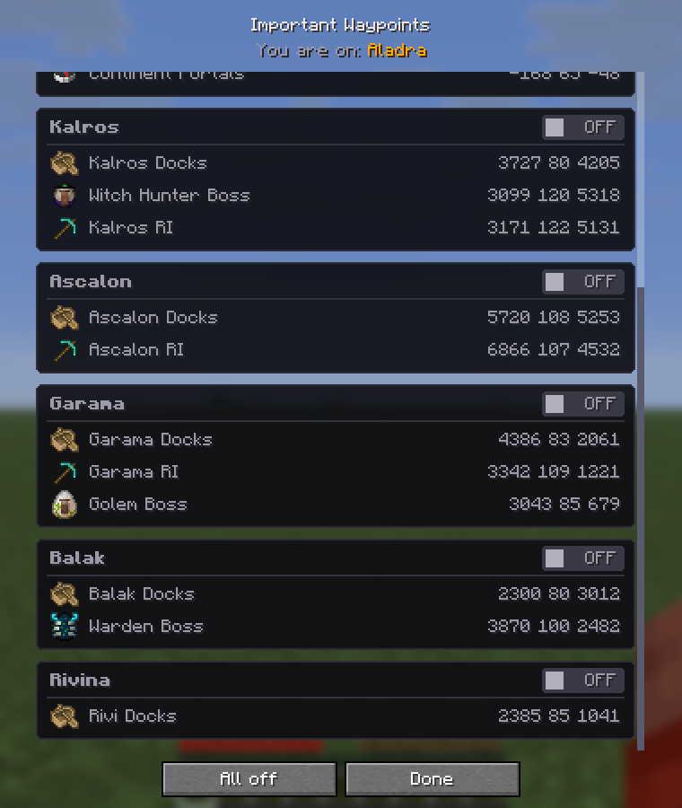

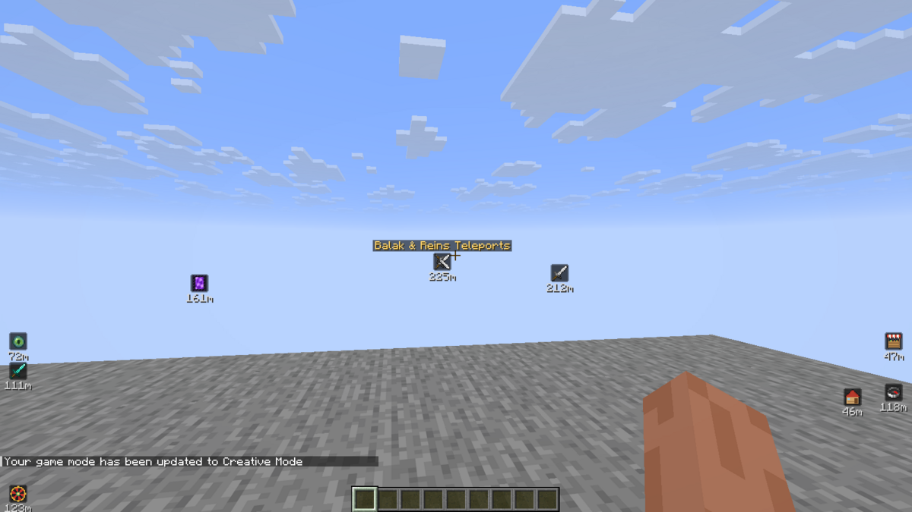

Which continent you are on is worked out from the world the server puts you in: its name if Loka
names its worlds after the continents, otherwise its **spawn point** — the game is told it on
arrival, every continent's is its docks (the map's own centres put them there to within forty
blocks), and Aladra's is near the middle of the world. When it cannot be told, nothing is drawn,
and the screen says so.

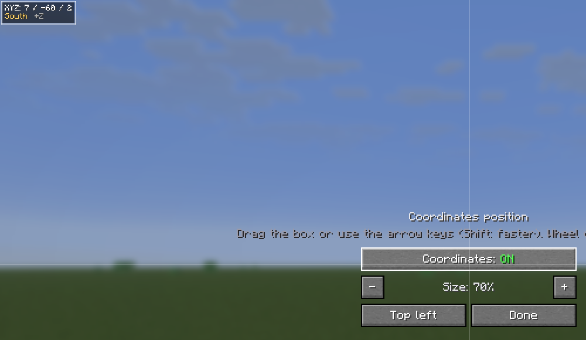

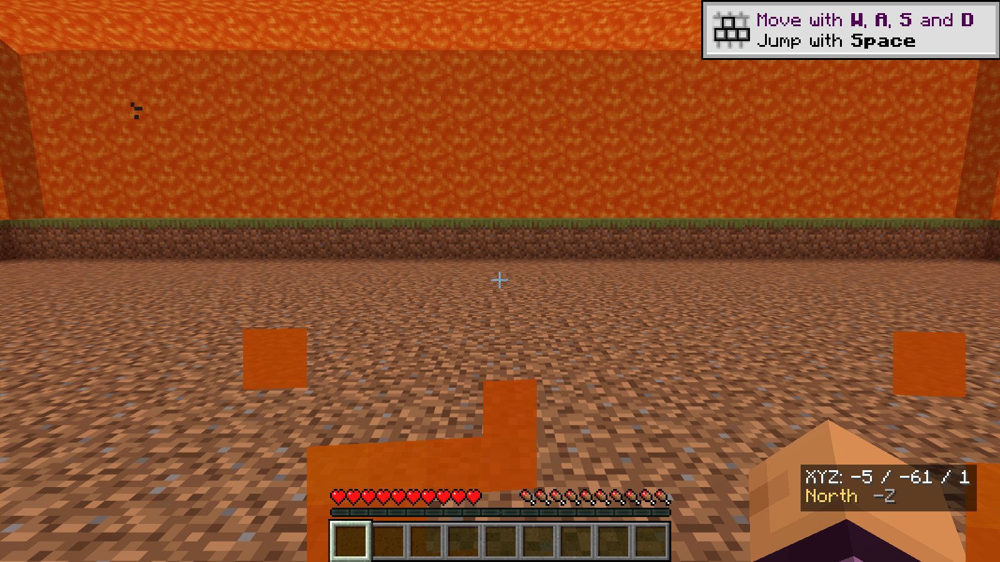

## Lore Creator

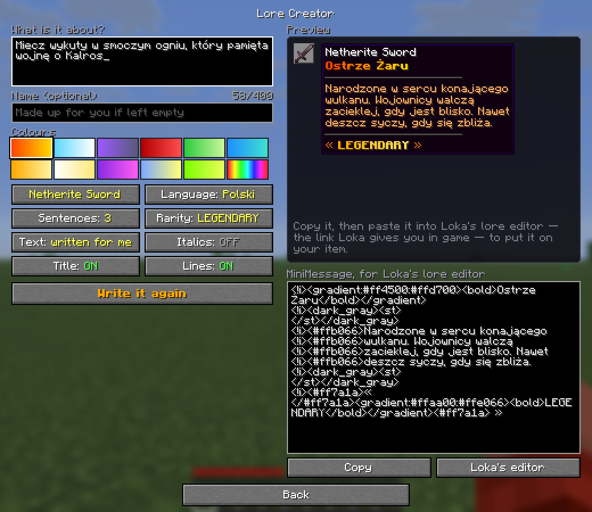

Describe an item — *a sword forged in dragon fire*, *lodowy łuk z północy* — pick a colour scheme,
and the mod writes its lore, in English or Polish, and shows it the way the game will: in a tooltip
under the item, in the game's own lore purple and italics wherever the lore does not say otherwise.

- **What it is about** decides what the lore says. The words in it — in either language — pick the
  motifs it is written from: fire, ice, shadow, blood, the wild, the sea, storms, holy light, the
  void, death, kings, war, ages past, the heart. Several at once are mixed. The kind of thing it is
  (sword, bow, axe, shield, crown, book...) decides the title's noun: *Blade of Embers*, *Ostrze
  Żaru*. **Write it again** writes another version of the same.
- **Text: my own** keeps your text instead and only styles it.
- **Colours**: twelve schemes — fire, ice, shadow, blood, nature, ocean, royal gold, holy light,
  void, storm, toxic and rainbow — each a gradient for the title, a colour for the text and an
  accent.
- Name, number of sentences, a **rarity** line (*Rare* to *Mythic*), a title line, dividers and
  italics on or off.

The lore is written in **MiniMessage**, the markup Loka's lore editor takes (it is Adventure's
MiniMessage Viewer): `<gradient:#ff4500:#ffd700><bold>`, `<#ffb066>`, `<!i>`, struck-through spaces
for a divider. It sits in an editable box under the preview — change anything and the preview
follows — and **Copy** puts it on the clipboard to paste into Loka's editor, the link Loka gives
you in game. The preview reads the same markup back with a MiniMessage reader of the mod's own
(colours, hex, decorations and their negations, gradients, rainbow, reset, new lines), so what it
shows is what the editor will make of it. Nothing is sent anywhere.

## Loka Assistant

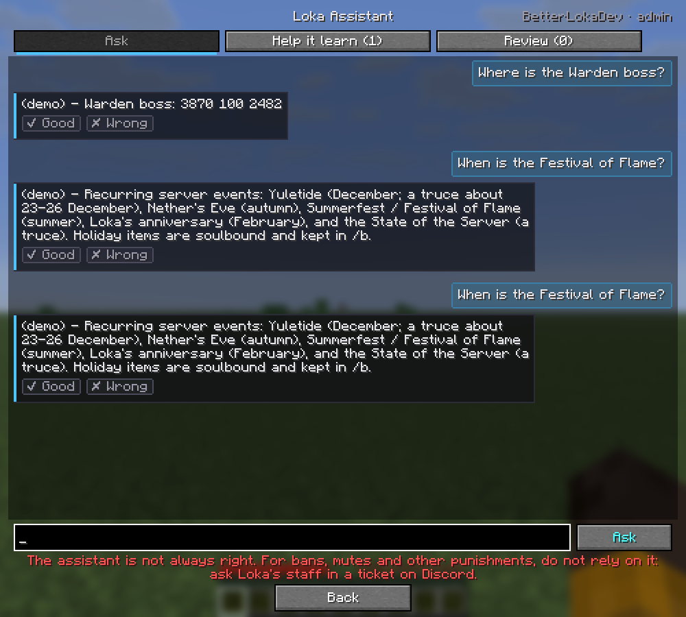

Ask anything about Loka — towns, conquest, bosses, the market, places, events — and an AI (Claude,
by Anthropic) answers in your language from what Loka has published and what players have taught it.
Each answer can be marked **✔ Good** or **✘ Wrong**.

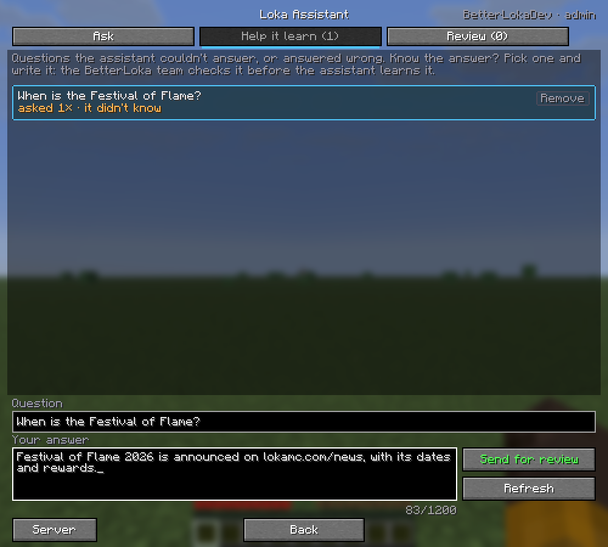

**Help it learn** lists what the assistant could not answer, and answers players marked wrong, most
asked first. Anyone can pick one and write the answer; it waits for the assistant's admins, who see
a **Review** tab the others do not, and only an approved answer goes into the knowledge base — from
the next question on. Nothing a player writes is learned on its own.

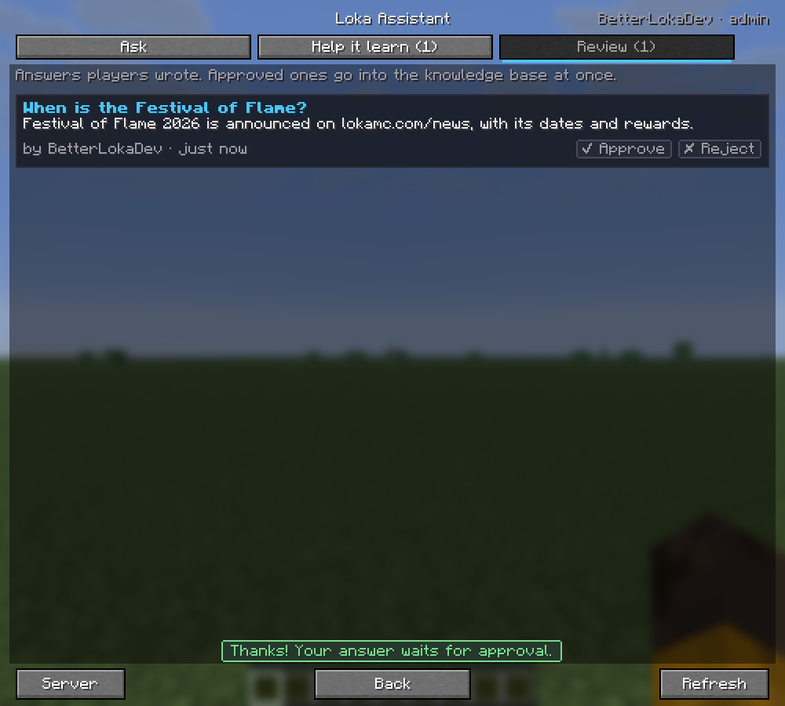

The answering happens on a **separate server** ([`assistant/`](assistant/README.md)), which holds the
Claude API key, the knowledge base, the budget and the per-player limits. The key is never in the mod,
where anyone could take it. The server's address is set once in the screen.

What is sent, and when: nothing until you open Loka Assistant and agree to the note it shows first.
From then on, opening it logs you in (your name, checked with Mojang as below), and asking, rating or
proposing an answer sends that — your question with the last few for context, and your game
language — to the assistant server, which asks Claude. Nothing goes to Loka's server. Your
account is checked with Mojang the way any Minecraft server checks it: the game tells Mojang you are
"joining" a one-time id from the assistant server, which then asks Mojang whether you did — your
password and Minecraft token never leave the game.

## What it costs a connection

Three of the things the mod reads are large and barely change, and re-fetching them every session was
most of what it cost — enough that on a home connection the Player Finder and the town pages could
look like they were not loading at all. They are cached to disk in `config/betterloka/`:

| Cached | Size | Kept for | Why that is safe |
| --- | --- | --- | --- |
| `towns.json` | 968 KB → 48 KB | 12 hours | Loka ships every town with its full member list; the mod uses a dozen fields, so only those are stored. |
| `fights.json` | ~110 KB per fight | 30 days | A finished fight's numbers never change again. |
| `arena-history-v2.json` | ~1.8 MB | 24 hours | A finished season's final table never changes again; only a complete index is saved. |
| `market-cache.json` | ~0.6 MB | until replaced (7 days at most) | Shown only until the background refresh lands. |
| `elo.json` | ~1.5 MB | until a newer version (14 days at most) | Replaced whenever the site publishes a new leaderboard. |

Measured end to end, opening the Player Finder and then the town roster:

| | Before | After (cold) | After (cached) |
| --- | --- | --- | --- |
| Town roster | 6755 ms | 99 ms | **99 ms** |
| Player Finder, complete | 2750 ms | 2153 ms | **1894 ms** |
| Downloaded | ~4 MB | ~1.2 MB | **~0.2 MB** |

The territory sweep also went from every 10 minutes to **every 30**, with the first one 5 minutes
after launch rather than 1 — starting the game already saturates a connection, and a sweep on top of
that is exactly when somebody opens the first screen.

### Nothing waits for a sweep

- **The market** is fetched ahead of time while you are online — straight after joining, then every
  ten minutes — and the last whole market is kept on disk (`market-cache.json`), so the square opens
  full at once, even on a fresh start, and a refresh replaces it when it lands. A search shows the
  offers already in hand immediately and swaps in the current ones a moment later.
- **The ranked ladders** are read straight after joining as well, both at once, and the best-rank
  index is built with every season in parallel (about four seconds rather than eight) — and only a
  complete index is saved. One that came back with a season missing used to be kept for the session
  and saved for a day, which is how a player's Best rank could stay blank.
- **Long jobs have their own lane.** The battle archive, the ranked history and the market sweep run
  on background threads of their own, so the Player Finder's own requests — the Loka record behind its
  headline, the fight pages — no longer queue behind minutes of somebody else's sweep.
- **The server's own budget is respected.** api.lokamc.com reports what is left of its rate limit with
  every answer; background work stays below its refill and stops short of the last ten on any node,
  so a sweep rarely draws a 429 — and when one does, only background work waits it out.

### What is not shown

**Charge success rate** is not available. EldritchBot publishes how many golems and lamps a player
has taken, but not how many they attempted, so a percentage cannot be computed without downloading
every fight that player has ever been in.

**Total currency on the server** is not available either — Loka's market endpoints cover listings,
not balances.

## Assistant server

[`assistant/`](assistant/README.md) is the server behind Loka Assistant: one jar that builds the
knowledge base (it reads Loka's website, the forum's announcements and the wiki, politely and within
their `robots.txt`, then has Claude write it up by topic) and answers players from it, within a
monthly budget it never goes over. Its README has the setup, the settings and what a question costs.

It also runs the Discord bot in the same process, so one panel server hosts both, and it can post the
questions it could not answer to a Discord channel, where members with a chosen role answer them
through a form and members with an approving role approve them into the knowledge base.

## Building

Requires JDK 25 — the version Minecraft 26.3 itself runs on, and the one the Fabric build tooling
now needs just to start. From 26.1 the game ships unobfuscated with Mojang's own names, so there are
no mappings to download and the code reads the same as the game.

```bash
./gradlew build          # jar lands in build/libs/
```

`./gradlew build` also builds the Discord bot (`bot/`) and the assistant server (`assistant/`).

## Testing

```bash
./gradlew test                            # offline: HTML/JSON parsing
./gradlew test -Pbetterloka.live=true     # also hits the live services end to end
```

The parsing tests run against fixtures shaped like the real markup; the live suite is what catches
those sites changing. It checks a real career, a real fight breakdown, the nameplate endpoint, the
not-found path, case-insensitive lookup, the market, translation in both directions, both ranked
ladders and the territory sweep — and asserts that a whole profile still costs only a handful of
requests.

Some of those live checks are load-bearing assumptions rather than parsing:

- the ranked history is only usable per season because a season's weekly snapshots are **cumulative**,
  so the test asserts a later week includes the earlier one;
- the Town Logger only works because Loka **leaves a deleted town's id on its territories**, so the
  test sweeps every continent and resolves each dangling holder against the deleted-town roster;
- the vulnerability window is only an hour of the day if it reads as one, so the test asserts it;
- the RIVI split rests on the map naming, so the test classifies a real player's recent fights and
  asserts no Conquest territory is ever filed as RIVI and no RIVI fight is a hundred players.

`FinderLatencyLiveTest` (live) is the Player Finder searched sixteen times in a row — renamed players
included — while the battle archive, the market, the ranked history and a stream of nameplate
lookups run alongside, as they do in the game. It prints each search's time, every 429 by host and
every request that took over a second and a half, which is how the stall described under *Why a
search is quick, every time* was found.

The offline suite covers the log's persistence too. Its baseline, its already-reported towns and its
alliance history are all written as records, and a serialiser that could not read them back would
look exactly like a logger that forgets everything on restart.

### Screenshots

The pictures in this README are taken by a real client, not mocked up. `BETTERLOKA_SHOTS=1` turns on
a driver that creates a flat world, walks the screens and saves each shot to `run/screenshots`:

```bash
BETTERLOKA_SHOTS=1 xvfb-run -a ./gradlew runClient
```

It is how the on-screen countdown is checked at all — a HUD element only renders in a loaded world,
so nothing about it can be verified from a title screen. Without the variable the driver is never
constructed.

## License

MIT. Not affiliated with or endorsed by Loka or EldritchBot.
